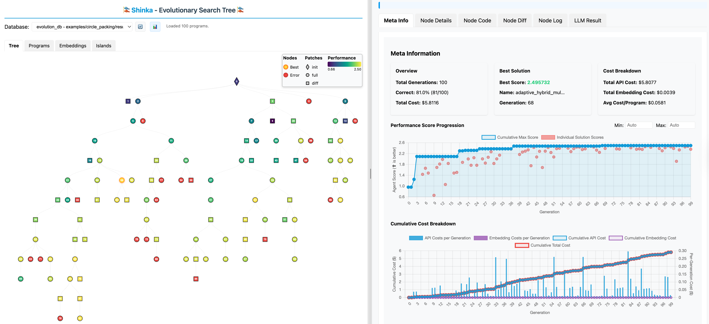

# WebUI Guide

The Shinka WebUI provides real-time visualization of the evolutionary process:
monitoring experiments, exploring solution genealogies, and analyzing metrics.

---

## Overview

- **Real-time Updates** — Live monitoring of ongoing experiments
- **Evolution Tree** — Interactive visualization of solution genealogies
- **Performance Metrics** — Fitness charts over generations
- **Code Diff Viewer** — Side-by-side comparison of evolved solutions
- **Island Visualization** — Multi-island evolution monitoring
- **Database Browser** — Explore archived solutions and metadata



---

## Quick Start

### Local experiment

```bash
# Start evolution
shinka_launch

# In another terminal, launch the WebUI
shinka_visualize --port 8888 --open

# Or specify a results directory
shinka_visualize results_20241201_120000/ --port 8888 --open

# Or target a specific database file
shinka_visualize --db results_20241201_120000/programs.sqlite --port 8888 --open
```

### Remote experiment

```bash
# On remote machine (listens on its localhost only)
shinka_visualize --port 8888

# On local machine (SSH tunnel)
ssh -L 8888:localhost:8888 username@remote-host

# Open http://localhost:8888
```

The server listens on `127.0.0.1` by default, so an SSH tunnel is the way in
from another machine. The tunnel has to end on the machine that runs the
server: `localhost` in `-L 8888:localhost:8888` is that machine's own
localhost. A tunnel that reaches the server over the network, such as
`-L 8888:compute-node:8888` through a login node, is refused unless the server
was started with `--host`. See [Remote Access](#remote-access).

### Async runner support

```bash
# Start async evolution
python run_evo.py

# Auto-detects database in current directory
shinka_visualize --open

# Or with specific results directory / database
shinka_visualize results_20241201_120000/ --open
shinka_visualize --db results_20241201_120000/programs.sqlite --open
```

---

## Launch Options

| Argument | Default | Description |
|----------|---------|-------------|
| `root_directory` | Current dir | Root directory to search for database files |
| `-p, --port` | `8000` | Port for the web server |
| `--host` | `127.0.0.1` | Address to listen on. `0.0.0.0` accepts connections from other machines |
| `--allowed-host` | None | Extra hostname browsers may use to reach the server (repeatable). See [Opening the UI by hostname](#opening-the-ui-by-hostname) |
| `--db` | Auto-detect | Path to specific SQLite database file |
| `--open` | `False` | Auto-open browser |

`--db` must lie inside `root_directory`. Given without a root directory, a
database outside the current directory makes its own folder the root.

---

## Features

### Evolution Tree

Genealogical relationships between solutions:

- **Nodes** — Individual solutions with fitness scores
- **Edges** — Parent-child relationships
- **Colors** — Performance-based color coding
- **Interactive** — Click nodes for details; zoom, pan, select, double-click to reset

### Performance Metrics

- Best/average fitness per generation
- Population diversity measures
- Mutation success rate
- Computational time per generation
- Island comparison and convergence analysis

### Code Diff Viewer

- Side-by-side parent vs child comparison
- Syntax highlighting and change highlighting
- Diff statistics (lines changed, complexity)
- Unified or split view

### Solution Browser

- Search, filter, and sort by fitness/generation/date
- Metadata view and export options
- Filter by generation range, fitness threshold, island ID, success status

### Island Visualization

- Island status and performance overview
- Migration tracking between islands
- Population diversity comparison

### Real-time Updates

- Configurable refresh intervals
- Progress indicators for ongoing evaluations
- Auto-scroll to follow latest generations

---

## Remote Access

### SSH tunneling

```bash
# Basic tunnel
ssh -L 8888:localhost:8888 username@remote-host

# Persistent connection
ssh -L 8888:localhost:8888 -N username@remote-host
```

### Cluster access

The WebUI runs on a compute node and you reach it through the login node.
Prefer the first form: the server stays on the compute node's localhost.

```bash
# On the compute node
shinka_visualize --port 8888

# On your machine: jump through the login node, tunnel to the compute node's localhost
ssh -J username@cluster-login-node -L 8888:localhost:8888 username@compute-node
```

If you cannot SSH to the compute node, the login node has to connect to it
over the cluster network, so the server must listen beyond localhost:

```bash
# On the compute node: listen on all interfaces
shinka_visualize --host 0.0.0.0 --port 8888

# On your machine
ssh -L 8888:compute-node:8888 username@cluster-login-node
```

With `--host 0.0.0.0` every user and process that can reach the compute node
on that port can read the run data under the root directory. Stop the server
when you are done, or pass the node's cluster-internal address to `--host`
instead of `0.0.0.0` to narrow who can connect.

Versions before the server listened on localhost only needed no `--host` for
this second form. If a tunnel that used to work now reports "connection
refused", this is why.

### Opening the UI by hostname

Through a tunnel you open `http://localhost:8888`, which always works. Opening
`http://<name>:8888` directly needs two things: the server must listen beyond
localhost (`--host`), and it must know `<name>` as its own. It refuses any
other name with `403 Host not allowed`, which keeps a website in your browser
from reaching it under a name of its choosing.

A server started with `--host` accepts `localhost`, any IP address, the
machine's hostname, its short name, `<name>.local` and the full name its
resolver reports. Start-up prints the list:

```
[*] Answering requests addressed to: localhost, node17, node17.cluster.example.org, node17.local, or any IP address. Add a name with --allowed-host.
```

For anything else, such as a DNS alias or a reverse proxy's name, add
`--allowed-host <name>`.

### Multiple experiments

```bash
shinka_visualize exp1/ --port 8888
shinka_visualize exp2/ --port 8889
```

---

## Troubleshooting

| Issue | Solution |
|-------|---------|
| Database not found | Specify path: `shinka_visualize --db /full/path/to/programs.sqlite` |
| `403 Host not allowed` | You opened the UI under a name the server does not know (DNS alias, reverse proxy). Start-up prints the names it accepts; restart with `--allowed-host <name>` to add one |
| Connection refused from another machine, or through a tunnel to `compute-node:8888` | The server listens on localhost only. Tunnel to the server's own localhost, or start it with `--host` (see [Remote Access](#remote-access)) |
| Port in use | Use different port: `--port 9000` |
| No data displayed | Check experiment has started, verify path, check permissions |
| SSH tunnel issues | Test with `curl http://localhost:8888`; debug with `ssh -v ...` |
| Browser issues | Hard refresh (Ctrl+F5), check firewall, try different browser |

---

## Advanced Usage

### API endpoints

The pages load their data from these JSON endpoints. `db_path` is a database
path relative to the root directory, as returned by `/list_databases`.

| Endpoint | Description |
|----------|-------------|
| `GET /list_databases` | Databases found under the root directory |
| `GET /get_database_stats?db_path=` | Program count, best score, cost and runtime |
| `GET /get_programs_summary?db_path=` | All programs without code or embeddings |
| `GET /get_programs?db_path=` | All programs with code and embeddings |
| `GET /get_program_details?db_path=&id=` | One program in full |
| `GET /get_program_count?db_path=` | Count and latest timestamp, for change detection |
| `GET /get_meta_files?db_path=` | Available meta-scratchpad updates |
| `GET /get_meta_content?db_path=&processed_count=` | One meta-scratchpad update |
| `GET /get_system_prompts?db_path=` | Evolved system prompts |
| `GET /get_plots?db_path=&generation=&program_id=` | Plot images saved by a program's evaluation |

### Embedding in Jupyter

```python
from IPython.display import IFrame
import subprocess, time

subprocess.Popen(['shinka_visualize', '--port', '8888'])
time.sleep(2)
IFrame('http://localhost:8888', width=1000, height=600)
```

### Security model

The WebUI has no login. It is built for one person looking at their own runs:

- It listens on `127.0.0.1` unless you pass `--host`.
- It reads only run files (databases, meta notes, failed-proposal artifacts)
  and plot images (`.png`, `.jpg`, `.jpeg`, `.gif`) inside the root directory,
  and follows no symlink out of it.
- It answers only requests addressed to `localhost`, an IP address, this
  machine's hostname or an `--allowed-host` name (with `--host`, also the
  machine's full and `.local` names), and sends no CORS headers, so another
  website open in your browser cannot read your runs.
- Program names, descriptions and meta notes are written by the model. The UI
  shows them as text and never runs markup they contain.
- Third-party scripts load from public CDNs pinned to exact versions with
  integrity hashes, so the UI needs internet access in the browser.

### Best practices

- Use SSH tunnels for remote access; never expose ports publicly
- Reduce refresh frequency for large experiments
- Regularly backup evolution databases
- Close WebUI when not actively monitoring
